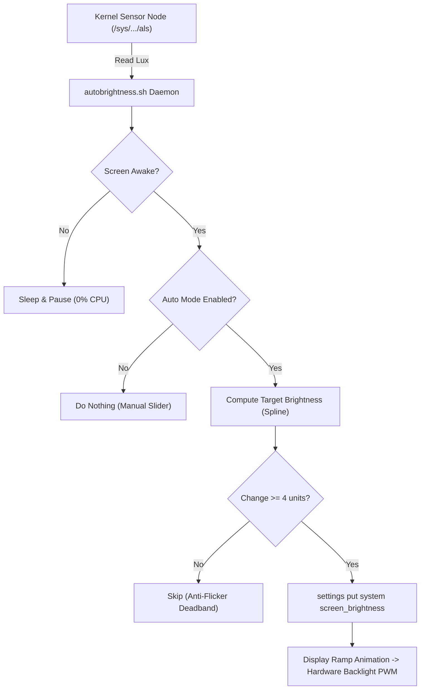

# tecno-kj6-autobrightness-fix

Dedicated KernelSU module for hardware-based automatic brightness on TECNO KJ6 (MT6789) running GSI.

## Overview
On AOSP/GSI, the native ambient light sensor (`stk3335x_als`) operates in the kernel, but the Android display framework fails to bind it. This module provides a minimal userspace daemon (`autobrightness.sh`) that reads the sysfs ambient light node directly and applies brightness via `settings put system screen_brightness`.

- **Sensor Node:** `/sys/devices/virtual/hf_manager/hf_manager/als`
- **Backlight Scale:** Configured for Transsion 12-bit PWM (0-4095).
- **Power Efficiency:** Pauses immediately when screen is off (`mWakefulness != Awake`). No wakelocks held.
- **Hysteresis:** $\ge 4$ deadband filter prevents flickering under fluctuating light.

## Workflow



## Compatibility
- **Tested Device:** TECNO KJ6 (Spark 20 Pro / MediaTek Helio G99 / MT6789).
- **Other Devices:** Likely compatible with other Transsion / MediaTek MT6789 devices exposing the same sysfs node.

## Configuration (`config.conf`)
```sh
MIN_BRIGHTNESS=8        # Minimum floor in darkness (1-50)
MAX_BRIGHTNESS=255      # Maximum ceiling in sunlight (100-255)
BRIGHTNESS_OFFSET=0     # Manual bias (+/-)
POLLING_INTERVAL=1.5    # Loop delay in seconds
FORCE_QS_AUTO_BUTTON=1  # Show 'A' toggle in crDroid/Lineage QS
```

## Installation
1. Download the latest `TECNO-KJ6-AutoBrightness-Fix-*.zip` from [Releases](../../releases).
2. Open the **KernelSU** app.
3. Go to the **Modules** tab, tap **Install**, select the downloaded zip, and flash it.
4. Reboot your device.

## License
[GPL-3.0](LICENSE) - Copyright (c) 2026 MEBUGO.
